# Практическая работа №1

**Дисциплина:** Технологии индустриального программирования

**Тема:** Подготовка окружения и первые программы на JavaScript

**Выполнила:** Полухина Елизавета Константиновна

**Группа:** ЭФБО-02-25

**Номер в журнале:** 22

**Вариант:** 6

## 1. Цель работы

Подготовить рабочее окружение для разработки на JavaScript, изучить запуск программ в Node.js и браузере, работу с типами данных, условиями и циклами, а также освоить проверку и отладку программ.

## 2. Используемые инструменты

| Инструмент | Версия |
|---|---|
| Node.js | v24.13.1 |
| npm | 11.8.0 |
| Git | 2.56.1.windows.1 |
| Редактор | Visual Studio Code |
| Браузер | Яндекс Браузер |
| Операционная система | Windows |

Версия npm проверена командой `npm.cmd --version`, поскольку PowerShell блокировал запуск сценария `npm.ps1`.

### Общая инструкция запуска

Команды выполняются из корня репозитория `tip-js-practices`:

```powershell
node practice-01/js/hello.js
node practice-01/js/types.js
node practice-01/js/progress.js
node practice-01/js/plan.js
node practice-01/js/debug.js
```

Для запуска в браузере необходимо открыть `practice-01/index.html`, указать нужный файл в атрибуте `src` тега `script`, сохранить HTML и обновить страницу. В каждый момент подключается только один учебный скрипт. Результаты отображаются во вкладке Console инструментов разработчика (F12).

## 3. Задание 1. Запуск JavaScript

Создан файл `js/hello.js`, содержащий информацию о студенте, группе и номере практической работы.

### Запуск в Node.js

Команда:

```powershell
node practice-01/js/hello.js
```

Результат:

```text
Студент: Полухина Елизавета Константиновна
Группа: ЭФБО-02-25
Практическая работа: 1
JavaScript успешно запущен
Тип document: undefined
```

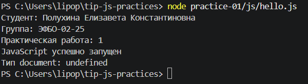

### Запуск в браузере

Файл подключён к `index.html` через тег `script`. Результат отображается в консоли разработчика.

```text
Студент: Полухина Елизавета Константиновна
Группа: ЭФБО-02-25
Практическая работа: 1
JavaScript успешно запущен
Тип document: object
```

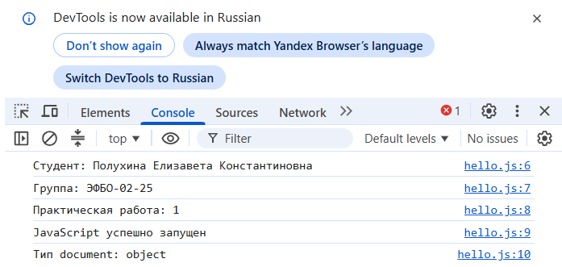

### Вывод

Один и тот же JavaScript-файл успешно выполняется в двух средах. В браузере доступен объект `document`, предназначенный для работы с HTML-страницей. При обычном запуске в Node.js этот объект отсутствует.

## 4. Задание 2. Типы данных и преобразования

Создан файл `js/types.js`. Проверены десять выражений с различными типами данных и операциями преобразования.

| Выражение | Ожидание до запуска | Фактическое значение | Тип результата | Объяснение |
|---|---|---|---|---|
| `"8" + 2` | 82 (string) | `"82"` | string | Объединение строки и числа |
| `"8" - 2` | 6 (number) | 6 | number | Строка преобразуется в число |
| `Number("8") + 2` | 10 (number) | 10 | number | Явное преобразование в число |
| `"12" > "3"` | false (boolean) | false | boolean | Посимвольное сравнение строк |
| `12 === "12"` | false (boolean) | false | boolean | Строгое сравнение учитывает типы |
| `Number("")` | 0 (number) | 0 | number | Пустая строка преобразуется в ноль |
| `Number("text")` | NaN (number) | NaN | number | Строка не содержит допустимого числа |
| `Boolean("false")` | true (boolean) | true | boolean | Непустая строка преобразуется в true |
| `typeof null` | object (string) | "object" | string | Историческая особенность JavaScript |
| `typeof NaN` | number (string) | "number" | string | NaN относится к числовому типу |

### Проверка через Node.js

```powershell
node practice-01/js/types.js
```

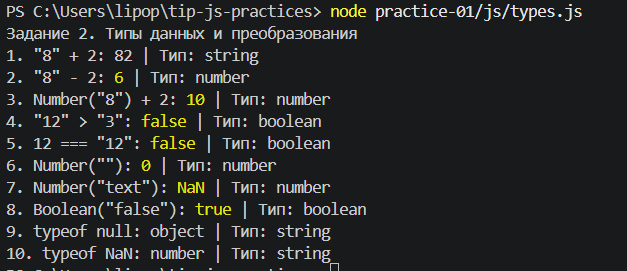

### Проверка в браузере

Для проверки файл `types.js` временно подключён к `index.html`. Результаты в консоли браузера совпали с результатами Node.js.

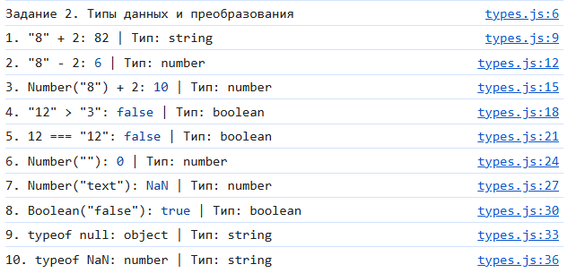

### Вывод

Изучены основные преобразования типов в JavaScript. Установлено, что результаты операций зависят от типов операндов. Особое внимание уделено строгому сравнению, преобразованию строк и значениям NaN и null.

## 5. Задание 3. Сводка выполнения задач

Создан файл `js/progress.js`.

### Исходные данные варианта 6

- Всего задач: 18

- Выполнено задач: 6

Программа проверяет корректность исходных значений, вычисляет оставшееся количество задач, процент выполнения и статус.

### Запуск

```powershell
node practice-01/js/progress.js
```

### Полученный результат

```text
Всего задач: 18
Выполнено: 6
Осталось: 12
Прогресс: 33.3%
Статус: В работе
```

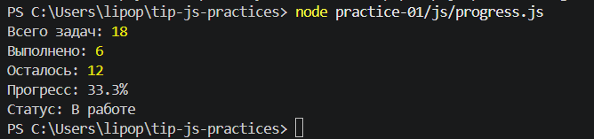

### Проверка в браузере

Результаты запуска в браузере совпали с результатами Node.js.

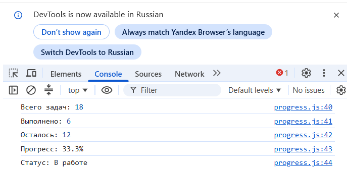

### Обязательные проверки

| № | Всего | Выполнено | Ожидаемый результат | Фактический результат | Итог |
|---|---|---|---|---|---|
| 1 | 12 | 5 | 7 осталось, 41.7%, В работе | 7 осталось, 41.7%, В работе | Совпало |
| 2 | 0 | 0 | Задач пока нет | Задач пока нет | Совпало |
| 3 | 5 | 0 | 5 осталось, 0.0%, Не начато | 5 осталось, 0.0%, Не начато | Совпало |
| 4 | 5 | 5 | 0 осталось, 100.0%, Завершено | 0 осталось, 100.0%, Завершено | Совпало |
| 5 | 5 | 6 | Ошибка | Ошибка | Совпало |
| 6 | -1 | 0 | Ошибка | Ошибка | Совпало |
| 7 | 5 | 2.5 | Ошибка | Ошибка | Совпало |
| 8 | "5" | 2 | Ошибка | Ошибка | Совпало |
| 9 | 1001 | 0 | Ошибка | Ошибка | Совпало |
| 10 | NaN | 0 | Ошибка | Ошибка | Совпало |
| Вариант 6 | 18 | 6 | 12 осталось, 33.3%, В работе | 12 осталось, 33.3%, В работе | Совпало |

### Пример проверки программы

Проверка при `totalTasks = 12` и `completedTasks = 5` показала корректный расчёт оставшихся задач, процента выполнения и статуса.

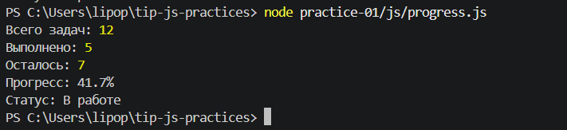

### Результаты тестирования

Проведено 10 проверок программы `progress.js`.

Все проверки завершились успешно. Программа корректно обрабатывает обычные и граничные случаи, а также отклоняет некорректные исходные данные: отрицательные числа, дробные значения, строки, NaN и количество задач более 1000.

После тестирования восстановлены исходные данные варианта №6: 18 задач, из которых 6 выполнено.

### Вывод по заданию 3

В ходе выполнения задания разработана программа расчёта прогресса выполнения задач. Реализованы проверка исходных данных, вычисление оставшихся задач, определение процента выполнения и статуса проекта.

Все 10 проверок подтвердили корректность работы программы.

## 6. Задание 4. Планирование задач по дням

Создан файл `js/plan.js`, в котором реализовано распределение оставшихся задач по дням с использованием цикла `while`.

### Исходные данные варианта 6

- Всего задач: 18

- Выполнено задач: 6

- Лимит выполнения: 5 задач в день

- Осталось задач: 12

### Алгоритм работы

Сначала программа проверяет корректность входных данных. Затем вычисляется количество оставшихся задач.

С помощью цикла `while` задачи распределяются по дням. На каждой итерации определяется количество задач, которое можно выполнить за текущий день. Для этого используется `Math.min()`.

Цикл завершается, когда количество оставшихся задач становится равным нулю.

### Команда запуска

```powershell
node practice-01/js/plan.js
```

### Ожидаемый результат для варианта 6

```text
Осталось задач: 12
День 1: выполнено 5, осталось 7
День 2: выполнено 5, осталось 2
День 3: выполнено 2, осталось 0
Потребуется дней: 3
```

### Фактический результат

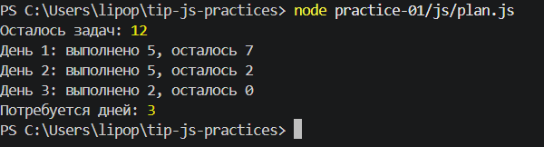

### Проверка в браузере

В консоли браузера получен план на три дня: 5, 5 и 2 задачи. Результаты совпали с выводом Node.js.

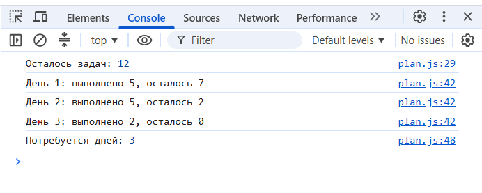

### Обязательные проверки

| № | Всего | Выполнено | Лимит | Ожидаемый результат | Фактический результат | Итог |
|---|---|---|---|---|---|---|
| 1 | 12 | 5 | 3 | 3 дня, последний день 1 задача | 3 дня, последний день 1 задача | Совпало |
| 2 | 10 | 4 | 3 | 2 дня, по 3 задачи | 2 дня, по 3 задачи | Совпало |
| 3 | 5 | 3 | 10 | 1 день, 2 задачи | 1 день, 2 задачи | Совпало |
| 4 | 5 | 5 | 2 | 0 дней | 0 дней | Совпало |
| 5 | 0 | 0 | 2 | 0 дней | 0 дней | Совпало |
| 6 | 5 | 2 | 0 | Ошибка | Ошибка | Совпало |
| 7 | 5 | 2 | 1.5 | Ошибка | Ошибка | Совпало |
| 8 | 5 | 6 | 2 | Ошибка | Ошибка | Совпало |
| 9 | 5 | 2 | "2" | Ошибка | Ошибка | Совпало |
| 10 | 5 | 2 | 1001 | Ошибка | Ошибка | Совпало |
| Вариант 6 | 18 | 6 | 5 | 3 дня, последний день 2 задачи | 3 дня, последний день 2 задачи | Совпало |

### Результаты тестирования

Проведено 10 проверок программы `plan.js`. Все ожидаемые результаты совпали с фактическими.

Программа корректно распределяет задачи по дням, учитывает дневной лимит и обрабатывает некорректные входные данные.

### Вывод

В ходе выполнения задания освоено использование цикла `while` для планирования задач. Для варианта №6 определено, что 12 оставшихся задач при лимите 5 задач в день можно выполнить за 3 дня.

## 7. Задание 5. Отладка JavaScript

Создан файл `js/debug.js`. В программе были обнаружены и исправлены ошибки, связанные с преобразованием типов данных и границей цикла.

### Обнаруженные ошибки

1. При сложении строк `"3"` и `"2"` получалось `"32"` вместо числа `5`.

2. Вычитание с использованием ошибочного результата давало `-24` вместо `3`.

3. Условие цикла `taskNumber < 4` исключало число 4, поэтому контрольная сумма составляла 6 вместо 10.

### Отладка

Для поиска ошибок использовался отладчик VS Code. Была установлена точка останова, выполнен пошаговый запуск с помощью F10 и просмотрены значения переменных в панели Variables.

### Скриншоты

**Результат до исправления:**

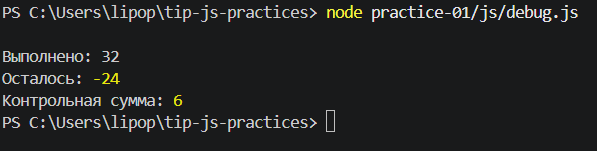

**Точка останова:**

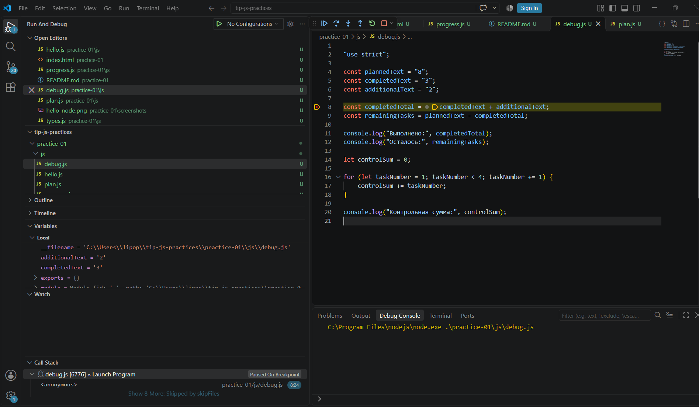

**Просмотр переменных:**

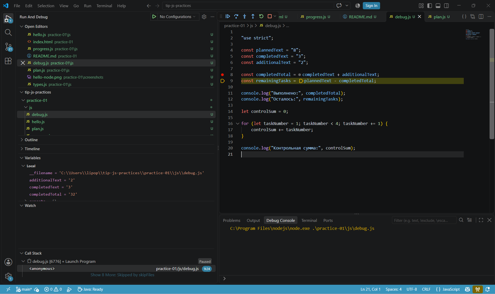

**Результат после исправления:**

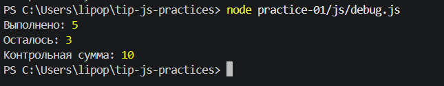

### Вывод

В ходе выполнения задания освоены установка точек останова, пошаговое выполнение программы и просмотр значений переменных. Исправлены ошибки преобразования строк в числа и условие завершения цикла.

### Дополнительная отладка в браузере (DevTools)

Файл `debug.js` подключён к `index.html`. Исходная версия программы была запущена в браузере и Node.js.

Фактический вывод до исправления:

```text
Выполнено: 32
Осталось: -24
Контрольная сумма: 6
```

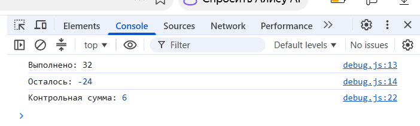

Во вкладке Sources установлена точка останова на строке вычисления `completedTotal`. После перезагрузки страницы в Scope исследованы исходные значения.

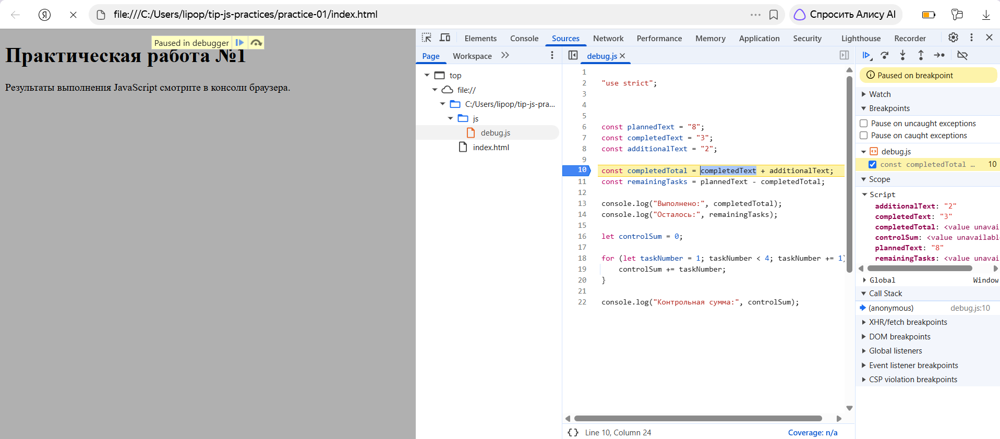

| Переменная | Значение | Тип |
|---|---|---|
| plannedText | `"8"` | string |
| completedText | `"3"` | string |
| additionalText | `"2"` | string |
| completedTotal (после F10) | `"32"` | string |
| remainingTasks (после следующего F10) | `-24` | number |

После первого шага F10 получена строка `"32"`, после второго — число `-24`.

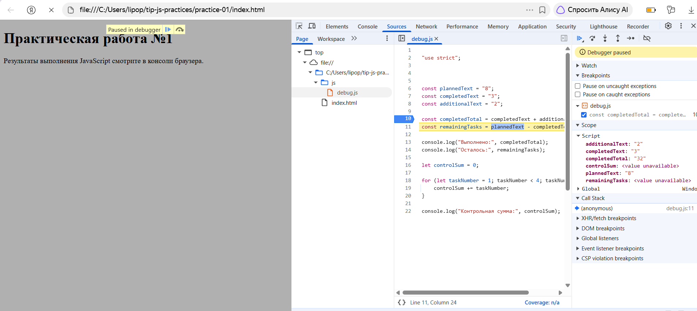

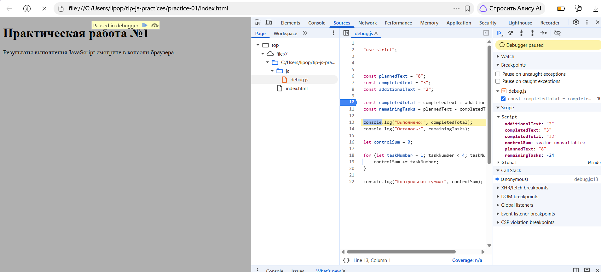

Затем точка останова перенесена внутрь цикла на строку `controlSum += taskNumber`. Последовательные остановки позволили исследовать изменение счётчика и суммы.

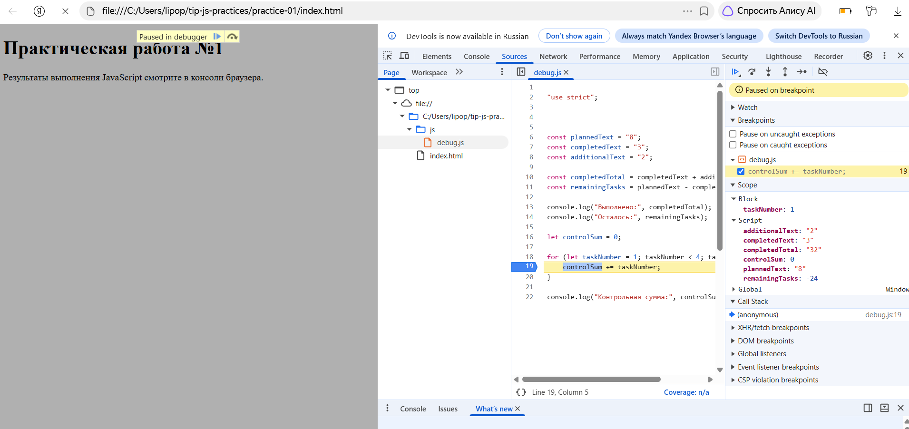

| Итерация | taskNumber | controlSum до сложения | controlSum после сложения |
|---|---:|---:|---:|
| 1 | 1 | 0 | 1 |
| 2 | 2 | 1 | 3 |
| 3 | 3 | 3 | 6 |

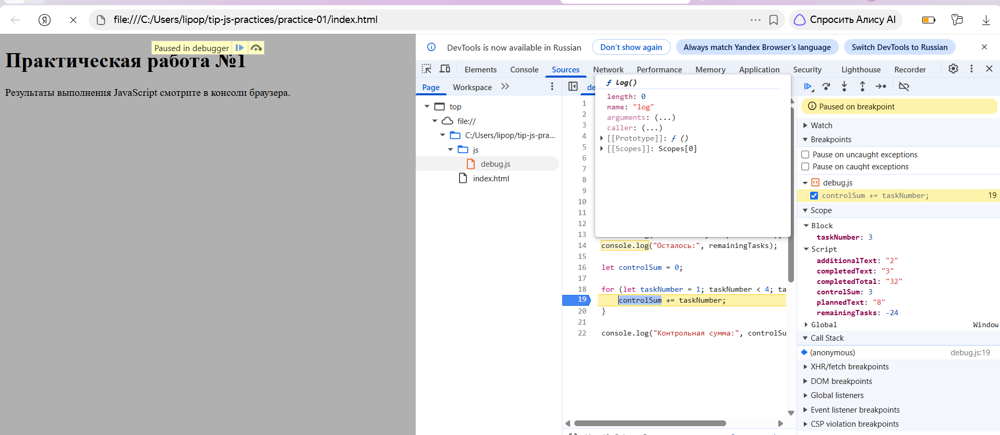

При достижении счётчиком значения 4 исходное условие становится ложным, поэтому четвёртая итерация отсутствует.

### Таблица ошибок и исправлений

| Ошибка | Что наблюдалось | Причина | Исправление | Результат после исправления |
|---|---|---|---|---|
| Обработка количества задач | `"32"` и `-24` | Сложение строк вместо чисел | Явное преобразование исходных строк через `Number()` | Выполнено 5, осталось 3 |
| Граница цикла | Контрольная сумма 6 | Условие `taskNumber < 4` исключает число 4 | Условие `taskNumber <= 4` | Контрольная сумма 10 |

После исправления активная точка останова была удалена. Программа повторно запущена в браузере и Node.js.

```text
Выполнено: 5
Осталось: 3
Контрольная сумма: 10
```

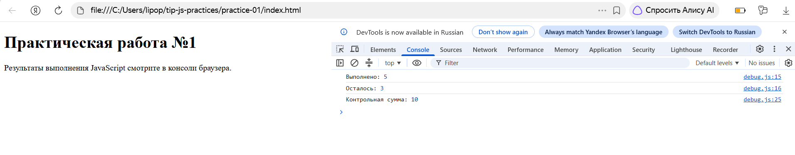

Результаты в обеих средах совпали.

## 8. Общий вывод

В ходе выполнения практической работы №1 были изучены основы языка JavaScript и способы запуска программ в средах Node.js и браузере.

Были выполнены все пять заданий: первый запуск JavaScript, исследование типов данных, расчёт прогресса выполнения задач, планирование задач по дням и отладка программы.

В процессе работы использовались переменные, арифметические операции, условные конструкции `if...else`, циклы `while` и `for`, а также методы проверки корректности входных данных.

Для программ `progress.js` и `plan.js` проведено по 10 тестов. Все проверки завершились успешно. При выполнении задания по отладке были обнаружены и исправлены ошибки преобразования типов данных и условия завершения цикла.

В результате были закреплены навыки написания, запуска, тестирования и отладки JavaScript-программ. Все задания практической работы выполнены, полученные результаты соответствуют ожидаемым.

Наиболее показательной оказалась ошибка сложения строк: программа выполнялась без исключений, но вместо числа 5 получалась строка `"32"`. Отладка через DevTools позволила установить причину ошибки по значениям и типам переменных.
