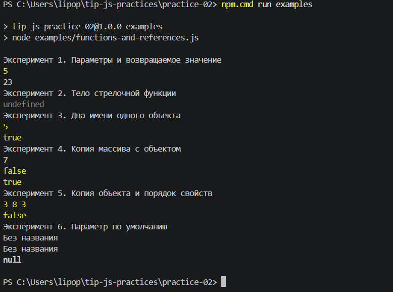
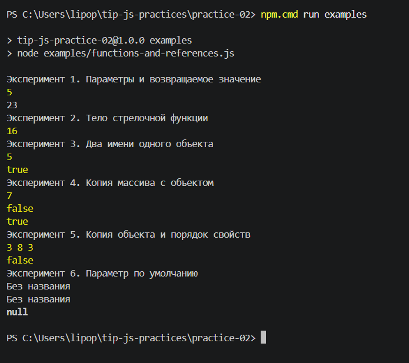
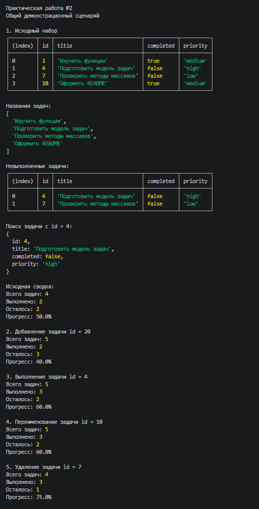
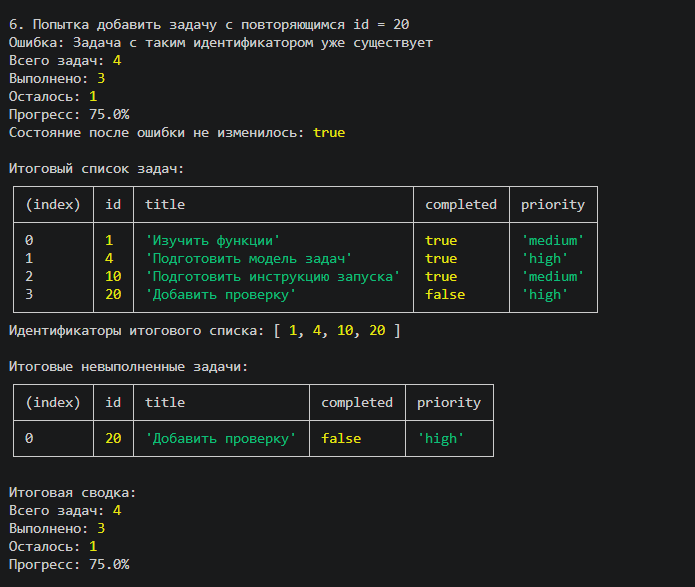
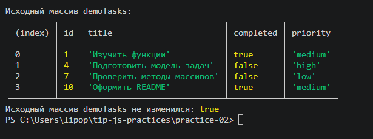
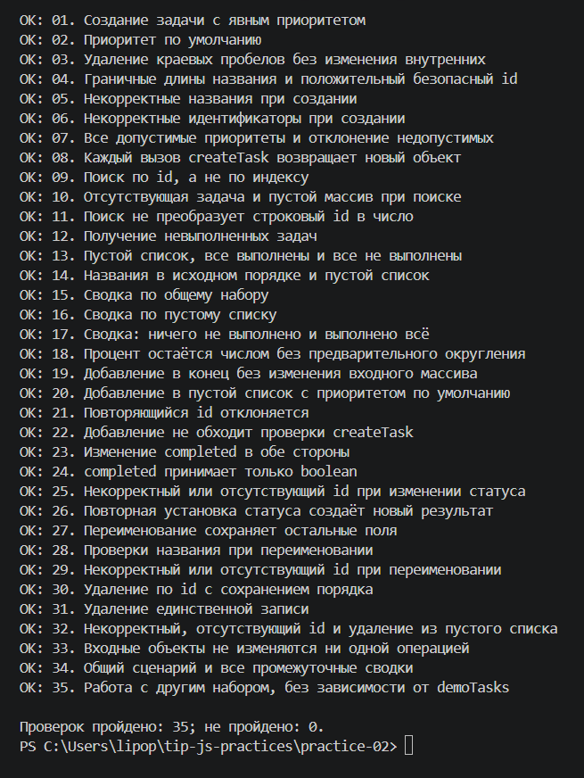
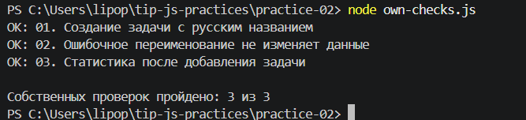

# Отчёт по практической работе № 2

**Тема:** Функции, объекты, массивы и организация кода

## 1. Автор и окружение

**Имя:** Полухина Елизавета Константиновна  
**Группа:** ЭФБО-02-25  
**Вариант:** 6  
**Операционная система:** Windows  
**Node.js:** v24.13.1  
**npm:** 11.8.0  

## 2. Запуск

Практическая работа выполняется в среде Node.js с использованием Visual Studio Code.

Для запуска программ из корня личного репозитория используются команды:

```powershell
node practice-02/examples/functions-and-references.js
node practice-02/src/main.js
node practice-02/checks.js
```

Для запуска из папки `practice-02` используются команды:

```powershell
npm.cmd run examples
npm.cmd start
npm.cmd run check
```

Команда `npm.cmd run examples` запускает учебные эксперименты с функциями, объектами и массивами.

Команда `npm.cmd start` запускает основной демонстрационный сценарий.

Команда `npm.cmd run check` запускает автоматическую проверку выполненных заданий.

В проекте отсутствуют внешние зависимости. Команда `npm.cmd install` была выполнена успешно, уязвимостей не обнаружено.


## 3. Функции, ссылки и копирование

В ходе выполнения задания были изучены особенности работы функций JavaScript, передачи аргументов, возвращаемых значений, ссылок на объекты и копирования массивов и объектов.

Для исследования использовался файл `examples/functions-and-references.js`, содержащий шесть независимых экспериментов.

Перед первым запуском программы были определены ожидаемые результаты. После выполнения команды `npm.cmd run examples` прогнозы сравнивались с фактическим выводом.

### 3.1. Результаты экспериментов

| № | Прогноз до запуска | Фактический результат | Причина |
|---:|---|---|---|
| 1 | `5`, `23` | `5`, `23` | При сложении двух чисел выполняется арифметическое сложение. Если один операнд является строкой, оператор `+` выполняет конкатенацию. |
| 2 | `undefined` | `undefined` | В теле стрелочной функции с фигурными скобками отсутствует оператор `return`, поэтому результат вычисления не возвращается. |
| 3 | `5`, `true` | `5`, `true` | Переменные `product` и `alias` ссылаются на один объект. Изменение свойства через одну переменную отражается при обращении через другую. |
| 4 | `7`, `false`, `true` | `7`, `false`, `true` | Оператор расширения `...` создаёт новый массив, но вложенный объект остаётся общим для исходного массива и копии. |
| 5 | `3 8 3`, `false` | `3 8 3`, `false` | Порядок свойств при копировании через `...` влияет на итоговое значение. При совпадении имён последнее присвоение перезаписывает предыдущее. |
| 6 | `Без названия`, `Без названия`, `null`, пустая строка | `Без названия`, `Без названия`, `null`, пустая строка | Значение параметра по умолчанию применяется при отсутствии аргумента или передаче `undefined`, но не при `null` и пустой строке. |

Все шесть прогнозов совпали с фактическими результатами первого запуска.

### 3.2. Исправление эксперимента №2

В эксперименте №2 была обнаружена ошибка, связанная с отсутствием оператора `return` в стрелочной функции.

Исходный код:

```javascript
const square = (value) => {
  value * value;
};
```

При вызове `square(4)` программа выводила:

```text
undefined
```

Для исправления ошибки был добавлен оператор `return`:

```javascript
const square = (value) => {
  return value * value;
};
```

После повторного запуска результат изменился:

```text
Эксперимент 2. Тело стрелочной функции
16
```

Таким образом, функция стала возвращать квадрат переданного числа.

### 3.3. Скриншоты выполнения

**Первоначальный запуск программы до исправления:**



**Повторный запуск программы после исправления:**



### 3.4. Вывод по заданию

В результате выполнения задания были изучены особенности работы обычных и стрелочных функций, передачи аргументов и возвращаемых значений.

Установлено, что объекты и массивы являются ссылочными типами данных. При поверхностном копировании массива вложенные объекты продолжают использовать общие ссылки.

Также изучено влияние порядка свойств при использовании оператора расширения `...` и особенности применения параметров функции по умолчанию.

Была исправлена ошибка в стрелочной функции путём добавления оператора `return`. После исправления функция стала возвращать ожидаемое значение `16`.

Все шесть экспериментов выполнены успешно.


## 4. Модель данных и функции

### Модель данных

Каждая задача представлена объектом со следующими полями:

| Поле | Тип данных | Назначение |
|---|---|---|
| id | number | Уникальный идентификатор задачи |
| title | string | Название задачи |
| completed | boolean | Статус выполнения задачи |
| priority | string | Приоритет задачи |

### Правила валидации

- Идентификатор должен быть положительным безопасным целым числом.
- Название должно быть строкой длиной от 1 до 100 символов после удаления крайних пробелов.
- Допустимые значения приоритета: low, medium, high.
- Приоритет по умолчанию — medium.
- Статус выполнения должен иметь логический тип boolean.
- При создании задачи статус completed равен false.
- В одном списке не допускаются задачи с одинаковыми идентификаторами.

### Назначение файлов

| Файл | Назначение |
|---|---|
| examples/functions-and-references.js | Эксперименты с функциями, ссылками и копированием объектов |
| src/task-service.js | Функции создания, поиска, фильтрации, изменения и удаления задач |
| src/main.js | Запуск демонстрационного сценария |
| src/data.js | Хранение исходного общего набора задач, номера варианта и индивидуального набора задач |
| checks.js | Автоматическая проверка корректности функций |
| package.json | Настройки проекта и команды запуска |
| own-checks.js | Выполнение трёх дополнительных собственных проверок |


### Описание операций

| Функция | Назначение | Результат при успехе | Результат при ошибке |
|---|---|---|---|
| createTask() | Создание новой задачи | Объект с ok: true и созданной задачей в поле task | Объект с ok: false и описанием ошибки в поле error |
| findTaskById() | Поиск задачи по идентификатору с помощью find() | Найденный объект задачи | undefined, если задача не найдена |
| getPendingTasks() | Получение невыполненных задач с помощью filter() | Новый массив невыполненных задач | Пустой массив, если невыполненных задач нет |
| getTaskTitles() | Получение названий задач с помощью map() | Массив названий в исходном порядке | Пустой массив при отсутствии задач |
| getTaskStats() | Расчёт статистики выполнения задач | Объект с полями total, completed, pending, progress | Для пустого массива все показатели равны 0 |
| addTask() | Добавление новой задачи в конец списка | Объект с ok: true и новым массивом tasks | ok: false и описание ошибки |
| setTaskCompleted() | Изменение статуса выполнения задачи | Объект с ok: true и обновлённым массивом tasks | ok: false и описание ошибки |
| renameTask() | Изменение названия задачи | Объект с ok: true и обновлённым массивом tasks | ok: false и описание ошибки |
| removeTask() | Удаление задачи по идентификатору | Объект с ok: true и новым массивом tasks | ok: false и описание ошибки |


**Почему id не равен индексу:** идентификатор является постоянным уникальным признаком задачи, а индекс определяет её текущую позицию в массиве. При удалении или перестановке элементов индексы могут изменяться, тогда как идентификаторы сохраняются.

**Почему getTaskStats возвращает число, а не строку с процентом:** числовое значение можно использовать для дальнейших вычислений, сравнения и форматирования. Округление и добавление знака процента должны выполняться при выводе результата, а не при расчёте статистики.

**Какие объекты копируются при изменении задачи:** создаётся новый массив задач и новый объект изменяемой задачи. Остальные объекты могут сохранять исходные ссылки, поскольку их содержимое не изменяется. Такой подход позволяет сохранить исходные данные без изменений.


## 5. Общий демонстрационный сценарий

Общий демонстрационный сценарий реализован в файле `src/main.js`.

Для запуска использована команда:

```powershell
npm.cmd start
```

После каждой операции выводится статистика выполнения задач. Фактические результаты сравнены с ожидаемыми результатами из методички.

| Этап | Ожидание: всего / выполнено / осталось / прогресс | Фактический результат | Итог |
|---|---|---|---|
| Исходный набор | 4 / 2 / 2 / 50.0% | 4 / 2 / 2 / 50.0% | Совпало |
| Добавление id 20 | 5 / 2 / 3 / 40.0% | 5 / 2 / 3 / 40.0% | Совпало |
| Выполнение id 4 | 5 / 3 / 2 / 60.0% | 5 / 3 / 2 / 60.0% | Совпало |
| Переименование id 10 | 5 / 3 / 2 / 60.0% | 5 / 3 / 2 / 60.0% | Совпало |
| Удаление id 7 | 4 / 3 / 1 / 75.0% | 4 / 3 / 1 / 75.0% | Совпало |

**Идентификаторы итогового списка:** [1, 4, 10, 20].

**Показанная ошибка и состояние после неё:** выполнена попытка добавления задачи с повторяющимся идентификатором 20. Программа вывела сообщение «Задача с таким идентификатором уже существует». Состояние массива не изменилось: всего 4 задачи, выполнено 3, осталась 1, прогресс 75.0%.

**Подтверждение неизменности demoTasks:** после выполнения всех операций исходный массив сохранил первоначальные значения, порядок элементов и статусы задач. Результат проверки неизменности — true.

### Итоговый список задач

| id | title | completed | priority |
|---|---|---|---|
| 1 | Изучить функции | true | medium |
| 4 | Подготовить модель задач | true | high |
| 10 | Подготовить инструкцию запуска | true | medium |
| 20 | Добавить проверку | false | high |

### Скриншоты выполнения







### Вывод

Общий демонстрационный сценарий выполнен успешно. Все фактические результаты совпали с ожидаемыми. Подтверждена корректность операций добавления, изменения и удаления задач, расчёта статистики и обработки ошибок без изменения исходных данных.


## 6. Проверки

**Команда запуска:** `npm.cmd run check`.

**Фактически пройдено проверок:** 35 из 35. Не пройдено: 0.

**Дата запуска и версия Node.js:** 24.11.2026, Node.js v24.13.1.

### Фактический вывод checks.js

```text
OK: 01. Создание задачи с явным приоритетом
OK: 02. Приоритет по умолчанию
OK: 03. Удаление краевых пробелов без изменения внутренних
OK: 04. Граничные длины названия и положительный безопасный id
OK: 05. Некорректные названия при создании
OK: 06. Некорректные идентификаторы при создании
OK: 07. Все допустимые приоритеты и отклонение недопустимых
OK: 08. Каждый вызов createTask возвращает новый объект
OK: 09. Поиск по id, а не по индексу
OK: 10. Отсутствующая задача и пустой массив при поиске
OK: 11. Поиск не преобразует строковый id в число
OK: 12. Получение невыполненных задач
OK: 13. Пустой список, все выполнены и все не выполнены
OK: 14. Названия в исходном порядке и пустой список
OK: 15. Сводка по общему набору
OK: 16. Сводка по пустому списку
OK: 17. Сводка: ничего не выполнено и выполнено всё
OK: 18. Процент остаётся числом без предварительного округления
OK: 19. Добавление в конец без изменения входного массива
OK: 20. Добавление в пустой список с приоритетом по умолчанию
OK: 21. Повторяющийся id отклоняется
OK: 22. Добавление не обходит проверки createTask
OK: 23. Изменение completed в обе стороны
OK: 24. completed принимает только boolean
OK: 25. Некорректный или отсутствующий id при изменении статуса
OK: 26. Повторная установка статуса создаёт новый результат
OK: 27. Переименование сохраняет остальные поля
OK: 28. Проверки названия при переименовании
OK: 29. Некорректный или отсутствующий id при переименовании
OK: 30. Удаление по id с сохранением порядка
OK: 31. Удаление единственной записи
OK: 32. Некорректный, отсутствующий id и удаление из пустого списка
OK: 33. Входные объекты не изменяются ни одной операцией
OK: 34. Общий сценарий и все промежуточные сводки
OK: 35. Работа с другим набором, без зависимости от demoTasks
```



Все 35 автоматических проверок успешно пройдены. Подтверждена корректность работы девяти реализованных функций, проверки входных данных, поиска, фильтрации, расчёта статистики, добавления, изменения и удаления задач.

Проверки также подтвердили, что исходные массивы и объекты не изменяются при выполнении операций.


### Собственные проверки

Три собственные проверки реализованы в отдельном файле `own-checks.js` с использованием встроенного модуля `node:assert/strict`.

Оригинальный проверочный сценарий преподавателя не изменялся.

**Команда запуска:**

```powershell
node own-checks.js
```

| Проверка | Входные данные | Ожидаемый результат | Фактический результат | Итог |
|---|---|---|---|---|
| Создание задачи с русским названием | id = 101, название с крайними пробелами, приоритет не указан | Пробелы удалены, приоритет medium | Название «Подготовить отчёт», приоритет medium | Пройдена |
| Ошибочное переименование | id = 101, название состоит только из пробелов | Возвращается ошибка, исходный массив не изменяется | ok: false, исходные данные сохранены | Пройдена |
| Статистика после добавления задачи | Добавление задачи id = 205 с приоритетом high | Всего 2, выполнено 0, осталось 2, прогресс 0% | Всего 2, выполнено 0, осталось 2, прогресс 0%, исходный массив содержит 1 задачу | Пройдена |

**Результаты выполнения:**

```text
OK: 01. Создание задачи с русским названием
OK: 02. Ошибочное переименование не изменяет данные
OK: 03. Статистика после добавления задачи

Собственных проверок пройдено: 3 из 3
```



Все три собственные проверки успешно пройдены.

Общее количество успешно пройденных проверок: 38 из 38, включая 35 автоматических проверок преподавателя и 3 собственные проверки.


## 7. Индивидуальный вариант

**Номер варианта:** 6.

**Предметная область набора задач:** проверка пользовательского интерфейса.

**Исходные данные:** [src/data.js](src/data.js).

Индивидуальный набор состоит из шести задач с идентификаторами 11, 23, 37, 41, 58, 64. Задачи связаны с проверкой навигации, кнопок, цветовой схемы, адаптивности интерфейса, полей формы и сообщений об ошибках.

Первые пять задач выполнены, последняя задача не выполнена. Используются все три допустимых приоритета: low, medium, high.

Ожидаемые результаты рассчитаны до запуска программы.

Порядок показателей: всего / выполнено / осталось / прогресс.

| Этап | Ожидание до запуска | Фактический результат | Итог |
|---|---|---|---|
| Шесть исходных задач | 6 / 5 / 1 / 83.3% | 6 / 5 / 1 / 83.3% | Совпало |
| Добавление id 80 | 7 / 5 / 2 / 71.4% | 7 / 5 / 2 / 71.4% | Совпало |
| Установка completed = true для id 11 | 7 / 5 / 2 / 71.4% | 7 / 5 / 2 / 71.4% | Совпало |
| Переименование id 23 | 7 / 5 / 2 / 71.4% | 7 / 5 / 2 / 71.4% | Совпало |
| Удаление id 37 | 6 / 4 / 2 / 66.7% | 6 / 4 / 2 / 66.7% | Совпало |
| Повторное добавление id 80 | Ошибка, состояние сохраняется: 6 / 4 / 2 / 66.7% | Ошибка, состояние сохранено: 6 / 4 / 2 / 66.7% | Совпало |

**Ожидаемые идентификаторы итогового списка:** [11, 23, 41, 58, 64, 80].

**Фактические идентификаторы итогового списка:** [11, 23, 41, 58, 64, 80].

**Ожидаемые идентификаторы невыполненных задач:** [64, 80].

**Фактические идентификаторы невыполненных задач:** [64, 80].

### Итоговый список задач

| id | title | completed | priority |
|---|---|---|---|
| 11 | Проверить работу навигации | true | high |
| 23 | Проверить кнопки и их состояния | true | medium |
| 41 | Проверить адаптивность интерфейса | true | high |
| 58 | Проверить поля формы | true | medium |
| 64 | Проверить сообщения об ошибках | false | high |
| 80 | Проверить отображение всплывающих окон | false | low |

### Особенности выполнения индивидуального сценария

При повторной установке completed = true для задачи с id 11 количество выполненных задач не изменилось, поскольку задача изначально была выполнена.

При этом программа подтвердила создание нового массива и нового объекта задачи:

```text
Создан новый массив: true
Создан новый объект задачи: true
```

При переименовании задачи с id 23 изменилось только её название. Идентификатор, статус выполнения и приоритет сохранились.

При повторном добавлении задачи с id 80 программа вывела сообщение об ошибке:

```text
Ошибка: Задача с таким идентификатором уже существует
Состояние после ошибки не изменилось: true
```

### Подтверждение неизменности исходных данных

После выполнения индивидуального сценария исходные массивы сохранили первоначальные значения и порядок элементов.

```text
Исходный массив variantTasks не изменился: true
Общий массив demoTasks не изменился: true
```

### Вывод

Индивидуальный вариант №6 выполнен успешно. Все фактические результаты совпали с предварительно рассчитанными ожиданиями.

Подтверждена корректность работы функций с индивидуальным набором данных, обработка повторяющихся идентификаторов и сохранение исходных массивов без изменений.

Итоговый прогресс выполнения задач составил 66.7%.


## 8. Расширение

Не выполнялось.

## 9. Вывод

## 9. Вывод

В ходе практической работы были изучены функции, объекты, массивы и принципы организации кода JavaScript.

По сравнению с практической работой №1 программа была разделена на отдельные модули, реализованы функции обработки данных и проверки входных параметров.

Возвращаемые значения функций используются для получения задач, расчёта статистики, обработки успешных операций и ошибок.

Неизменность исходных массивов и объектов подтверждена автоматическими проверками, общим и индивидуальным демонстрационными сценариями.

В ходе выполнения экспериментов была исправлена ошибка отсутствия оператора return в стрелочной функции.

Успешно пройдены 35 автоматических и 3 собственные проверки. Общий демонстрационный сценарий и индивидуальный вариант №6 выполнены успешно.

Все обязательные задания практической работы выполнены.


## 10. Самопроверка

- [x] Все девять функций реализованы; заглушек в `src/task-service.js` не осталось.
- [x] Общий и индивидуальный сценарии запускаются без ручной правки исходных данных.
- [x] Пройдены проверки, включая ошибки и сохранность входных объектов.
- [x] Фактические результаты не подменены ожидаемыми.
- [x] Инструкция запуска проверена из указанной рабочей папки.
- [x] Код и отчёт отправлены в существующий учебный репозиторий.

